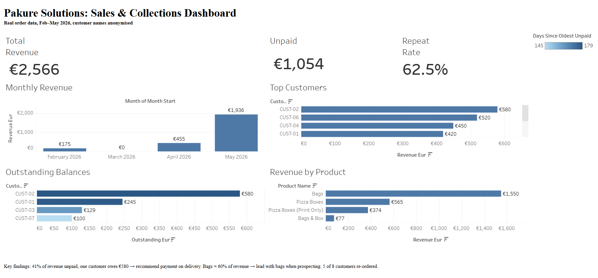

# Pakure Analytics

**An end-to-end analytics project built on the real order data of my own packaging business: Python cleaning, a PostgreSQL database, SQL metric views and a published Tableau dashboard that shows where the money is and where it's stuck.**

[**View the live dashboard on Tableau Public**](https://public.tableau.com/app/profile/ibrahim.abushaban/viz/PakureSolutionsDashboard/PakureDashboard)

[](https://public.tableau.com/app/profile/ibrahim.abushaban/viz/PakureSolutionsDashboard/PakureDashboard)

## Background
Pakure Solutions is a custom-branded packaging business (pizza boxes, paper bags) that I founded in April 2025 and run myself, selling to cafés, restaurants and takeaways in Dublin. Orders were tracked in a Google Sheet. This project turns that sheet into a database and a dashboard so I can make decisions from it. A second, clearly separated layer of **simulated** data (June–October 2026) models a sales funnel, because the tracker has no record of businesses I approached or quotes I sent.

## Business questions it answers
- How much revenue are we making each month, and is it growing?
- Which customers matter most, and which ones re-order?
- How much money is owed to us, by whom, and for how long?
- Which products sell best, and what is a typical order worth?
- Sales funnel (simulated data): how many businesses approached turn into quotes and customers, and which quotes are still waiting for a reply?

## Key findings
**These findings come from the REAL data only**: 15 orders from 8 customers, Feb–May 2026 (a small sample, so treat these as signals rather than statistics). The simulated data plays no part in them, and the published dashboard shows real data only.

- **Cash is the biggest issue.** 41% of revenue (€1,054 of €2,566) is unpaid, and one customer owes €580 across four orders. The oldest unpaid orders date from April 2026. *Recommendation: ask for payment on delivery.*
- **Bags drive the business.** Bags are 60% of revenue (€1,550). *Recommendation: lead with bags when prospecting.*
- **Customers come back.** 5 of 8 customers (62.5%) have re-ordered, which suggests the product is good enough to earn repeat business.
- **Growth is recent.** Revenue went from €175 in February to €1,936 in May, with no orders in March. The tracker currently ends in May 2026.

## Tech stack
| Part | Tool |
|---|---|
| Cleaning and loading | Python 3, pandas, psycopg 3 |
| Database | PostgreSQL |
| Metrics | SQL views |
| Dashboard | Tableau Public |
| Version control | Git + GitHub |

## How the pipeline works
```
Google Sheets export (raw, local only)
        │  scripts/clean_orders.py   fixes data problems, anonymises customers
        ▼
data/clean/orders_clean.csv ──┐   data/synthetic/*.csv  (SIMULATED, flagged)
        │                      │            ▲
        │                      │            │  scripts/generate_synthetic.py (fixed seed)
        │  scripts/load_db.py  ◄─────────────┘  creates DB, runs sql/01_schema.sql, loads real then
        ▼                                       simulated data, runs sql/02_views.sql
PostgreSQL  (customers, products, orders, order_items, prospects, quotes + 8 metric views)
        │  scripts/export_views.py   one CSV per view
        ▼
dashboard/data/*.csv  →  Tableau Public
```

- **Cleaning** (`clean_orders.py`): splits the mixed delivery/payment status into two fields, separates brand from branch, standardises product names, parses DD/MM/YYYY dates explicitly, sorts by date, and stops with an error on unexpected values instead of guessing.
- **Database** (`sql/01_schema.sql`): six tables with foreign keys, `CHECK` constraints and `NUMERIC` money columns so totals are exact to the cent. Foreign keys include the `is_synthetic` flag, so the database itself rejects a simulated order for a real customer (and the reverse).
- **Metrics** (`sql/02_views.sql`): monthly revenue, revenue by customer, repeat-customer rate, outstanding balance with ageing, revenue by product, plus the sales funnel, outstanding quotes and quote conversion. Every view has a `data_source` column (`Real` / `Simulated`) to filter on. All metric logic lives in SQL, and Tableau only draws it.
- **Validation:** after loading, the script checks the real data against the spreadsheet, filtered to `is_synthetic = false` (15 orders, 8 customers, €2,565.99 total, €1,511.59 paid, €1,054.40 unpaid, 1 invoice number). It then checks the simulated data (row counts, every won prospect linked to a customer, every simulated order belongs to a simulated customer).
- **Why CSV exports for Tableau?** Tableau Public can't connect to a PostgreSQL server, so views are exported to files. See [PLAN.md](PLAN.md).

## Data honesty
Real and simulated data are kept apart everywhere, and neither is presented as the other.

**Real data**
- 15 orders from 8 customers, from my own order tracker, February to May 2026.
- Customers are **anonymised** (`CUST-01`, `BRAND-01`, …) before anything is committed. The raw export, which has real names, stays on my computer and is git-ignored.
- All findings above come from this data only.

**Simulated data**
- June to 15 October 2026: about 90 prospects, their quotes, the new customers they become (`SIM-CUST-01`, …) and those customers' orders. It is generated by `scripts/generate_synthetic.py` with a fixed random seed, so it is reproducible.
- It exists to model a sales funnel, because the tracker has no record of businesses I approached or quotes I sent. It is **not** a record of what happened.
- Quantities, prices, product mix and the unpaid rate are drawn from ranges in the real data. The funnel rates (about 40% of prospects quoted, about a third of quotes accepted) are assumptions I set, not measurements.
- No channel or business-type advantage is built in, and nothing is designed to show that any recommendation worked. Differences between channels or business types in the funnel views are random noise from a small sample.
- Simulated rows have `is_synthetic = true` in every table, are written to their own files in `data/synthetic/`, and appear as `Simulated` in the `data_source` column of every view. The database refuses to link a simulated record to a real one.

In combined views, real customers show no orders after May 2026 because the tracker ends there and simulated orders only go to simulated customers, so this is not real churn.

Known limitation: the unit of `Qty` (individual boxes vs packs) isn't documented in the tracker, so per-unit figures are indicative only.

## How to run it
Requires Python 3.10+ and a local PostgreSQL server.

```bash
pip install -r requirements.txt
cp .env.example .env            # then fill in DB_PASSWORD
python scripts/generate_synthetic.py  # optional: regenerates data/synthetic/ (already committed)
python scripts/load_db.py       # creates the "pakure" database, schema, real + simulated data, views
python scripts/export_views.py  # writes dashboard/data/*.csv
```

The repo includes the anonymised `data/clean/orders_clean.csv`, so you can run the steps above without the raw file. To rebuild from your own export, put it at `data/raw/orders_raw.csv` (title on row 1, headers on row 2) and run `python scripts/clean_orders.py` first.

## Project structure
```
data/clean/        anonymised, cleaned REAL orders (safe to commit)
data/synthetic/    SIMULATED customers, orders, prospects and quotes (safe to commit)
sql/               01_schema.sql (tables), 02_views.sql (metric views)
scripts/           clean_orders.py, generate_synthetic.py, load_db.py, export_views.py
dashboard/         screenshot, packaged Tableau workbook, exported view CSVs
PLAN.md            project plan and decisions
```

## Author
Ibrahim Abushaban, founder of Pakure Solutions. [LinkedIn](https://www.linkedin.com/in/ibrahim-abushaban)
